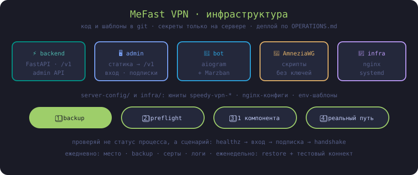

# MeFast VPN




Исходный код и инфраструктурные конфигурации MeFast VPN. Репозиторий намеренно
не содержит пользовательских данных, ключей, сертификатов, VPN-конфигураций,
SQLite-баз или рабочих `.env`.

## Состав

- `apps/backend` — FastAPI facade для приложения и административного API.
- `apps/admin` — статическая веб-админка, которая обращается к backend по `/v1`.
- `apps/telegram-bot` — отдельный aiogram-бот, работающий с Marzban.
- `apps/amneziawg` — скрипты управления AmneziaWG без ключей и клиентских конфигураций.
- `infra` — nginx, systemd, Marzban и безопасные шаблоны переменных окружения.
- `docs/OPERATIONS.md` — порядок проверок, деплоя и восстановления.

## Локальная проверка backend

Требуется Python 3.11+.

```powershell
cd apps/backend
python -m venv .venv
.\.venv\Scripts\python -m pip install -e ".[dev]"
.\.venv\Scripts\python -m pytest
```

Для запуска нужен отдельный локальный файл `.env`, созданный из
`infra/env/backend.env.example`. Никогда не добавляйте его в Git.

## Статус production

Этот репозиторий является источником кода и конфигурационных шаблонов. Перед
любой выкладкой на сервер следуйте [операционной инструкции](docs/OPERATIONS.md):
сначала резервная копия, затем preflight, затем одна изменяемая компонента и
проверка её реального HTTP/VPN-пути.
